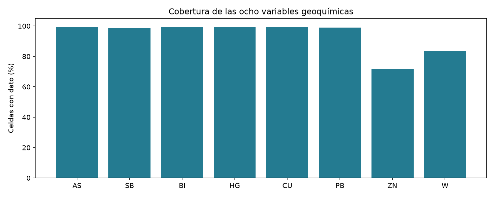
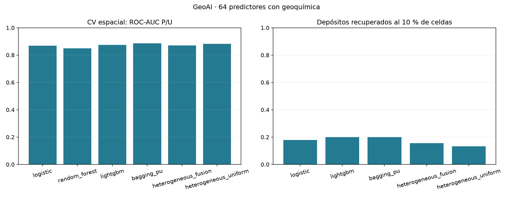
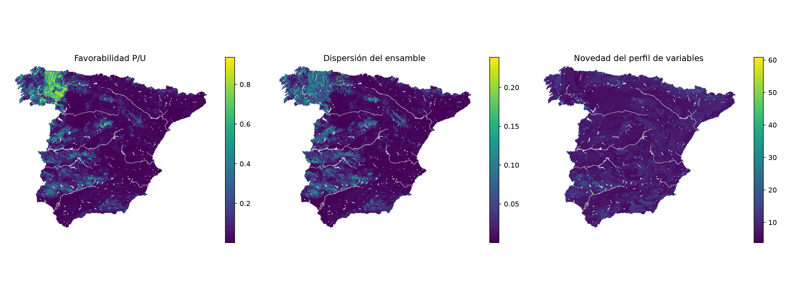
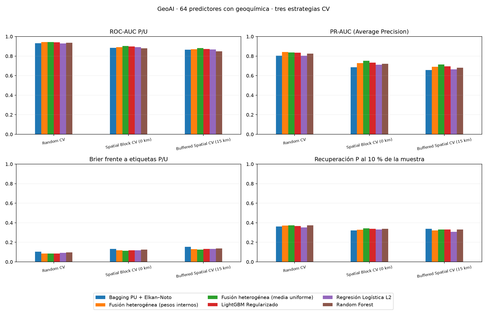
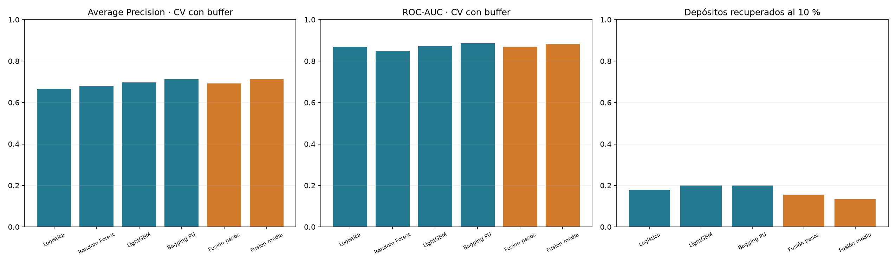
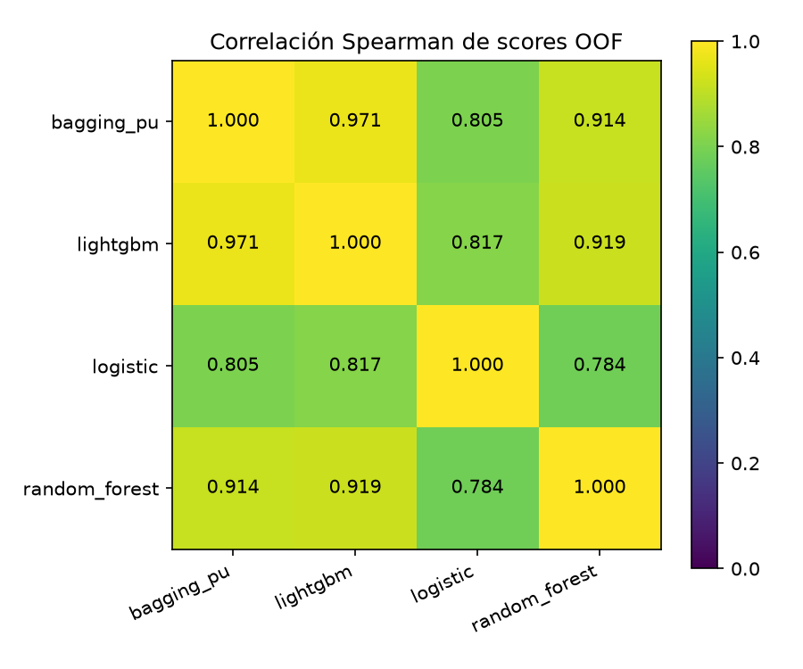
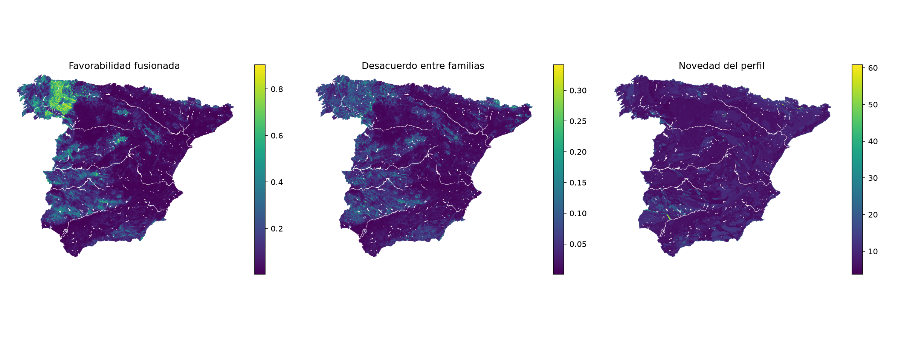

# GeoAI · Prospectividad aurífera con geoquímica

El sistema integra 64 predictores en una malla de un kilómetro EPSG:25830. El dominio contiene 478,443 celdas; 753 registros elegibles se consolidan en 664 celdas P. La evaluación territorial abarca 45 depósitos agrupados en 32 distritos.

Bagging PU obtiene ROC-AUC 0.8866 y Average Precision 0.7119 en predicciones fuera de pliegue. En siete rotaciones territoriales recupera 5 de 45 depósitos al 5 % de celdas y 9 al 10 %.

## Datos y variables predictivas

Los 64 predictores describen 19 fracciones litológicas, 27 fracciones de edades, tres distancias estructurales, seis variables de relieve, una hidrológica y ocho variables geoquímicas. Los identificadores, coordenadas, bloques, depósitos y estados de revisión organizan el trabajo y no son predictores. El inventario contiene 790 registros: 190 confirmados, 597 pendientes y tres rechazados. Tras el cruce con el dominio se utilizan 175 confirmados y 578 pendientes. La unidad de aprendizaje es la celda: se prioriza el peso de la evidencia confirmada cuando coinciden registros.

## Geoquímica: fuentes, variables y significado

Se incorporan As (arsénico), Sb (antimonio), Bi (bismuto), Hg (mercurio), Cu (cobre), Pb (plomo), Zn (zinc) y W (wolframio). Estas capas aportan información sobre la distribución superficial de asociaciones geoquímicas potencialmente relacionadas con los sistemas mineralizantes. La relación depende del contexto geológico: un elemento acompañante no constituye por sí solo una prueba de oro.

Las fuentes son capas cartográficas del atlas geoquímico, integradas mediante su clasificación de colores y agregadas como clase modal de cada celda. El catálogo de cada clase, color RGB e intervalo local está en leyendas_geoquimicas.csv. Esos intervalos conservan la transcripción de las leyendas locales; su medio de muestreo, extracción y unidades requieren contraste con la ficha oficial de cada capa. El modelo utiliza códigos categóricos, sin convertirlos en concentraciones analíticas verificadas ni asumir que la distancia entre códigos es una distancia química.

| variable | coverage_percent | missing_percent | positive_missing_cells | classes |
| --- | --- | --- | --- | --- |
| as_clase_modal | 99.0866 | 0.9134 | 1 | 0;1;2;3;4;5;6;7 |
| sb_clase_modal | 98.7679 | 1.2321 | 1 | 0;1;2;3;4;5;6;7 |
| bi_clase_modal | 99.0866 | 0.9134 | 1 | 0;1;2;3;4;5;6;7 |
| hg_clase_modal | 99.0866 | 0.9134 | 1 | 0;1;2;3;4;5;6;7 |
| cu_clase_modal | 99.0866 | 0.9134 | 1 | 0;1;2;3;4;5;6;7 |
| pb_clase_modal | 98.8709 | 1.1291 | 3 | 0;1;2;3;4;5;6;7 |
| zn_clase_modal | 71.6631 | 28.3369 | 109 | 0;1;2;4;5;6;7 |
| w_clase_modal | 83.5284 | 16.4716 | 103 | 0;1;3;4;5;6 |

La clase cero es válida. Los ausentes se imputan como categoría -1 y se codifican mediante one-hot; las categorías se aprenden exclusivamente dentro del entrenamiento de cada partición. Una categoría no observada se gestiona con handle_unknown=ignore. Las variables numéricas se imputan con la mediana del entrenamiento, añaden indicadores de ausencia cuando procede y se estandarizan. El número de columnas transformadas depende de las categorías presentes en entrenamiento; 64 es el número de variables de entrada.

Zn y W presentan la menor cobertura. Se conserva su ausencia de forma explícita y se exporta un contador de elementos ausentes por celda. El dominio se define por el soporte geológico y de relieve; no se descartan celdas por carecer de algún elemento. La falta de cobertura puede aportar señal del muestreo y exige interpretación contextual. Au queda fuera de los predictores para reducir el riesgo de circularidad con el inventario que define la señal objetivo.

## Uso de los elementos dentro del ensamble

La tabla agrega por variable original la ganancia de las divisiones de los árboles, reuniendo sus categorías one-hot. En cada miembro se normaliza por la ganancia total y después se calcula la media y la desviación entre los ocho miembros. Describe el uso de las variables durante el ajuste; no mide causalidad, contribución individual a cada celda ni una mejora predictiva atribuible al elemento. La correlación, la cantidad de categorías y el patrón de ausencias pueden influir en estos valores.

| variable | mean_gain_fraction | std_gain_fraction |
| --- | --- | --- |
| as_clase_modal | 0.0977 | 0.0085 |
| bi_clase_modal | 0.0494 | 0.0085 |
| sb_clase_modal | 0.0356 | 0.0062 |
| hg_clase_modal | 0.0175 | 0.0043 |
| zn_clase_modal | 0.0140 | 0.0045 |
| pb_clase_modal | 0.0117 | 0.0041 |
| cu_clase_modal | 0.0057 | 0.0030 |
| w_clase_modal | 0.0051 | 0.0038 |

Las 64 variables se documentan en importancia_variables.csv. Esta inspección global se completa con la consulta de las clases y las capas de cada localización.

## Aprendizaje con presencias y territorio no etiquetado

Las celdas con indicios son P y el resto es U: no se asume que el territorio no inventariado carezca de mineralización. La confianza se incorpora como peso: confirmada=1, pendiente=0.5, U=1. Si coinciden varios registros se toma el peso máximo. Se muestrean hasta tres U por P, con semillas fijadas y particiones exportadas.

Se evalúan logística L2, Random Forest, LightGBM y Bagging PU. Este último conserva P y remuestrea U para cada miembro. La evaluación espacial de este apartado utiliza scores relativos del ensamble. El benchmark de tres estrategias desarrollado más adelante incorpora Bagging PU + Elkan–Noto con una reserva interna para c; el reescalado no acredita por sí solo probabilidades físicas de depósito.

## Validación espacial

Se utilizan cinco pliegues por bloques de 50 km, excluyendo del pool los bloques de los distritos de reserva. Se retiran del entrenamiento las muestras a menos de 15 km de las muestras de validación. Imputación, escalado y codificación se ajustan solo con entrenamiento. Las métricas se calculan sin ponderar, sobre las predicciones fuera de pliegue de la muestra P/U.

| model | n_input_features | roc_auc | average_precision | positive_cell_recovery_at_05 | positive_cell_recovery_at_10 |
| --- | --- | --- | --- | --- | --- |
| logistic | 64 | 0.8680 | 0.6648 | 0.1653 | 0.3084 |
| random_forest | 64 | 0.8497 | 0.6803 | 0.1749 | 0.3307 |
| lightgbm | 64 | 0.8734 | 0.6963 | 0.1685 | 0.3307 |
| bagging_pu | 64 | 0.8866 | 0.7119 | 0.1733 | 0.3307 |
| heterogeneous_fusion | 64 | 0.8701 | 0.6915 | 0.1717 | 0.3211 |
| heterogeneous_uniform | 64 | 0.8827 | 0.7141 | 0.1701 | 0.3323 |

La recuperación de esta tabla mide celdas P dentro de la muestra de evaluación, no depósitos ni superficie nacional. ROC-AUC mide ordenación de etiquetas P/U; Average Precision depende también de la composición de la muestra.

## Evaluación territorial por distritos

Se reentrena en siete rotaciones, reservando grupos de distritos completos, sus bloques y un buffer de 15 km respecto a las celdas de esos bloques. También quedan excluidos los indicios sin distrito que se sitúan en ese territorio. Se puntúan todas las celdas reservadas; un depósito se recupera si alguna celda asociada entra en el 1 %, 5 % o 10 % mejor puntuado del grupo. Los empates se resuelven por cell_id, sin utilizar la etiqueta.

| model | n_deposits | captured_deposits_at_01 | captured_deposits_at_05 | captured_deposits_at_10 | deposit_recovery_at_10 |
| --- | --- | --- | --- | --- | --- |
| logistic | 45 | 2 | 4 | 8 | 0.1778 |
| lightgbm | 45 | 3 | 5 | 9 | 0.2000 |
| bagging_pu | 45 | 1 | 5 | 9 | 0.2000 |
| heterogeneous_fusion | 45 | 2 | 4 | 7 | 0.1556 |
| heterogeneous_uniform | 45 | 2 | 6 | 6 | 0.1333 |

Estas rotaciones permiten examinar transferencia regional dentro del inventario conocido. Los ajustes comparten datos entre rotaciones; una campaña nueva permitiría evaluar la utilidad prospectiva externa.

## Cartografía, estabilidad e interpretación

La cartografía nacional se obtiene con ocho miembros LightGBM ajustados después de evaluar, utilizando las 664 celdas P y diferentes muestras U. Cada miembro tiene 150 árboles y una muestra de hasta 3 U por P. La evaluación de Bagging PU utiliza 5 miembros de 100 árboles y hasta 2 U por P dentro de su muestra de entrenamiento; sus métricas corresponden a ese protocolo y no son un test independiente de los ocho objetos nacionales.

Se exportan media de favorabilidad, desviación del ensamble, novedad, percentil de score, categoría y número de variables geoquímicas ausentes. La novedad es la distancia euclídea al centroide P en el espacio numérico estandarizado y categórico one-hot del primer miembro. La dispersión mide sensibilidad entre miembros, no toda la incertidumbre geológica. La inspección de variables permite relacionar la prioridad con sus evidencias; no se calculan SHAP ni EBM en esta cadena.

Las categorías son: 1 novedad elevada (distancia superior al percentil 95); 2 favorabilidad alta y dispersión baja; 3 favorabilidad alta y dispersión alta; 4 favorabilidad menor y dispersión baja; 5 favorabilidad menor y dispersión elevada. Favorabilidad alta usa el percentil 90 y dispersión alta el percentil 75. Son umbrales relativos al dominio.

| category | cells | fraction |
| --- | --- | --- |
| 1 | 23923 | 0.0500 |
| 2 | 340 | 0.0007 |
| 3 | 45009 | 0.0941 |
| 4 | 344182 | 0.7194 |
| 5 | 64989 | 0.1358 |

## Reproducción y productos

Ejecutar .venv-fase-a/Scripts/python.exe scripts/ejecutar_geoquimica.py desde la raíz. La configuración está en config/geoquimica_20261017.yaml. El notebook 18 reúne el recorrido completo; el 04 detalla geoquímica y el 17 presenta mapas y consulta de celdas. Los notebooks de preparación y modelado leen la misma configuración y los mismos resultados.

reports/geoquimica_20261017 contiene variables, cobertura, leyendas, registros, particiones, métricas, ocho modelos joblib y cartografía Parquet/GeoTIFF EPSG:25830. Los manifiestos SHA-256 registran entradas, código y salidas; environment.json conserva el entorno. El sistema apoya priorización regional y revisión geológica. No estima leyes, reservas ni rentabilidad; su aplicación se completa con contraste geológico y trabajo de campo.

# Validación de tres estrategias y propensión

El experimento emplea **64 predictores**, incluidas las clases geoquímicas As, Sb, Bi, Hg, Cu, Pb, Zn y W. Las tres estrategias comparten 629 P y 1887 U, excluyendo los bloques de los distritos de reserva. Se ajustan cinco pliegues por estrategia.

## Factor c estimado sobre el catálogo

**c = 0.431122; escala de referencia 1/c = 2.3195×.**

El diagnóstico parte de las 664 celdas P del catálogo elegible y 1992 U. Reserva espacialmente 530 celdas, de las que 154 son P, para estimar c. Ajusta con 1778 celdas, excluyendo la reserva y un buffer de 15 km. Las transformaciones se aprenden exclusivamente con el ajuste.

En cada miembro, **c_b = media de g_b(x) sobre positivos de la reserva interna**. Se calcula **q_b(x) = clip(g_b(x)/c_b, 0, 1)** y el ensamble promedia q_b. La c informada es la media de los cinco c_b. Su inversa resume una escala de referencia: con factores distintos y recorte no equivale a dividir la media del ensamble por una única constante.

El 43.11 % expresa el score medio aparente de los positivos reservados bajo este diseño P/U. Identificarlo con probabilidad de registro exige selección aleatoria de positivos (SCAR), un clasificador probabilístico adecuado y un muestreo compatible. Aquí U se muestrea y los positivos tienen pesos de confianza: el valor no acredita qué porcentaje del oro o de los depósitos reales está inventariado.

El factor del catálogo pertenece al ensamble diagnóstico guardado en models/catalog_elkan_noto.joblib. La cartografía conserva sus ocho pipelines de scores relativos; no se les aplica automáticamente el factor de otro ajuste. Los factores del benchmark se estiman dentro del entrenamiento de cada pliegue, sin consultar su test externo.

## Modelos y tres estrategias de validación

| Estrategia CV | Modelo | ROC-AUC | PR-AUC | Brier Loss | Recovery@5% | Recovery@10% |
| --- | --- | --- | --- | --- | --- | --- |
| Random CV | Regresión Logística L2 | 0.9299 | 0.8044 | 0.0927 | 18.4400 | 35.2900 |
| Random CV | Random Forest | 0.9352 | 0.8250 | 0.0977 | 18.6000 | 37.3600 |
| Random CV | LightGBM Regularizado | 0.9409 | 0.8356 | 0.0846 | 18.2800 | 36.7200 |
| Random CV | Bagging PU + Elkan–Noto (c=0.601) | 0.9312 | 0.8040 | 0.1030 | 17.3300 | 36.0900 |
| Random CV | Fusión heterogénea (pesos internos) | 0.9443 | 0.8420 | 0.0855 | 18.7600 | 37.2000 |
| Random CV | Fusión heterogénea (media uniforme) | 0.9434 | 0.8360 | 0.0859 | 18.6000 | 37.3600 |
| Spatial Block CV (0 km) | Regresión Logística L2 | 0.8905 | 0.7111 | 0.1186 | 17.0100 | 33.2300 |
| Spatial Block CV (0 km) | Random Forest | 0.8795 | 0.7207 | 0.1262 | 17.3300 | 33.7000 |
| Spatial Block CV (0 km) | LightGBM Regularizado | 0.8985 | 0.7341 | 0.1181 | 17.3300 | 33.7000 |
| Spatial Block CV (0 km) | Bagging PU + Elkan–Noto (c=0.529) | 0.8841 | 0.6859 | 0.1329 | 16.3800 | 32.2700 |
| Spatial Block CV (0 km) | Fusión heterogénea (pesos internos) | 0.8912 | 0.7275 | 0.1189 | 17.4900 | 32.9100 |
| Spatial Block CV (0 km) | Fusión heterogénea (media uniforme) | 0.9040 | 0.7517 | 0.1128 | 17.6500 | 34.3400 |
| Buffered Spatial CV (15 km) | Regresión Logística L2 | 0.8680 | 0.6648 | 0.1332 | 16.5300 | 30.8400 |
| Buffered Spatial CV (15 km) | Random Forest | 0.8497 | 0.6803 | 0.1382 | 17.4900 | 33.0700 |
| Buffered Spatial CV (15 km) | LightGBM Regularizado | 0.8734 | 0.6963 | 0.1322 | 16.8500 | 33.0700 |
| Buffered Spatial CV (15 km) | Bagging PU + Elkan–Noto (c=0.465) | 0.8663 | 0.6565 | 0.1541 | 15.9000 | 33.7000 |
| Buffered Spatial CV (15 km) | Fusión heterogénea (pesos internos) | 0.8701 | 0.6915 | 0.1309 | 17.1700 | 32.1100 |
| Buffered Spatial CV (15 km) | Fusión heterogénea (media uniforme) | 0.8827 | 0.7141 | 0.1254 | 17.0100 | 33.2300 |

Random CV utiliza cinco pliegues estratificados. Spatial Block CV separa bloques de 50 km sin buffer. Buffered Spatial CV utiliza los mismos pliegues espaciales y retira muestras de entrenamiento a menos de 15 km de validación. Las tres estrategias emplean las mismas 64 variables.

Logística L2, Random Forest y LightGBM ajustan su Pipeline con todo el entrenamiento externo. Bagging PU + Elkan–Noto combina cinco LightGBM y reserva un pliegue interno para c con el mismo tipo de separación aleatoria o espacial de la estrategia. El test externo no participa en el ajuste ni en c; la reserva interna reduce la muestra efectiva del procedimiento PU.

## Interpretación de las métricas

- **ROC-AUC:** ordenación de etiquetas P/U sobre predicciones fuera de pliegue.
- **PR-AUC:** conserva la definición de la tabla solicitada, Average Precision calculada con average_precision_score. El área trapezoidal se exporta separadamente como pr_auc_trapezoid; son cálculos diferentes.
- **Brier Loss:** error cuadrático medio frente a etiquetas P/U. No evalúa calibración de mineralización real: U no es ausencia confirmada y la muestra tiene un ratio P/U definido por el experimento.
- **Recovery@5% y @10%:** porcentaje de celdas P recuperadas en un cupo exacto de ceil(porcentaje × celdas de la muestra). Los empates se resuelven por cell_id sin utilizar etiquetas. No mide depósitos ni superficie nacional.

El recorte en uno puede crear empates. Se exportan scores brutos y corregidos para inspeccionar el cálculo, manteniendo el presupuesto de selección.

## Factores c por estrategia

| strategy | c_mean | c_std | fraction_score_one |
| --- | --- | --- | --- |
| Random CV | 0.6009 | 0.0106 | 0.1399 |
| Spatial Block CV (0 km) | 0.5294 | 0.0493 | 0.1037 |
| Buffered Spatial CV (15 km) | 0.4653 | 0.0729 | 0.1411 |

c_mean y c_std resumen los 25 factores de cinco miembros en cinco pliegues. fraction_score_one es la fracción de scores finales OOF iguales a uno. Ningún c utiliza los positivos del test externo.

## Reproducción

benchmark_cv_tabla.csv es la tabla de presentación; benchmark_cv_summary.csv conserva precisión completa y el área PR trapezoidal. benchmark_cv_folds.csv y benchmark_cv_oof.parquet permiten recalcular métricas. Se exportan las pertenencias externas e internas y las predicciones de los positivos usados para c. propensity_catalog_summary.json registra factores, tamaños y alcance; propensity_catalog_score_examples.csv muestra el reescalado. Ejecutar scripts/ejecutar_geoquimica.py --stage diagnostics y después --stage report.

Referencia: [Elkan y Noto (2008), sección 2](https://cseweb.ucsd.edu/~elkan/posonly.pdf).

# GeoAI · Fusión heterogénea de modelos

Se combinan logística L2, Random Forest, LightGBM y Bagging PU sobre las mismas 64 entradas, incluidas las ocho clases geoquímicas. Se evalúan la media uniforme, con peso fijo 0,25 para cada componente, y una fusión que aprende pesos en CV interna. Bagging PU agrega miembros de una familia; estas fusiones reúnen algoritmos con estructuras diferentes. La correlación entre sus scores fuera de pliegue permite inspeccionar su complementariedad. Ese diagnóstico es descriptivo y no elige pesos sobre el test.

## Aprendizaje de pesos sin utilizar el test externo

El score es **S(x)=Σ w_j s_j(x)**, con pesos no negativos que suman uno. La media uniforme fija w_j=0,25 sin usar etiquetas para ajustarlos. En la fusión con pesos aprendidos, cada entrenamiento externo genera predicciones fuera de pliegue de los cuatro componentes mediante tres pliegues internos. La separación interna reproduce la estrategia aleatoria, por bloques o con buffer de 15 km. Imputación, escalado y one-hot se ajustan dentro de cada entrenamiento interno.

Se evalúa una rejilla simplex de paso 0.1 y la media de pesos iguales. Se selecciona Average Precision interna; los empates favorecen pesos menos concentrados. La rejilla permite peso cero y seleccionar un único componente cuando la mezcla no añade señal interna. Los cuatro pipelines se reajustan después con todo el entrenamiento externo y los pesos quedan fijados antes de predecir el test. El procedimiento completo, incluida esta selección, se evalúa en los cinco pliegues externos.

Se combinan scores P/U sin corrección Elkan–Noto. La optimización de ranking absorbe diferencias de escala dentro del entrenamiento, sin convertir las salidas en probabilidades físicas calibradas. El c del diagnóstico pertenece a su modelo específico.

## Resultados en CV espacial con buffer

| model | roc_auc | average_precision | positive_cell_recovery_at_05 | positive_cell_recovery_at_10 |
| --- | --- | --- | --- | --- |
| logistic | 0.8680 | 0.6648 | 0.1653 | 0.3084 |
| random_forest | 0.8497 | 0.6803 | 0.1749 | 0.3307 |
| lightgbm | 0.8734 | 0.6963 | 0.1685 | 0.3307 |
| bagging_pu | 0.8866 | 0.7119 | 0.1733 | 0.3307 |
| heterogeneous_fusion | 0.8701 | 0.6915 | 0.1717 | 0.3211 |
| heterogeneous_uniform | 0.8827 | 0.7141 | 0.1701 | 0.3323 |

La **media uniforme** obtiene **AP 0.714075** y **ROC-AUC 0.882745**. La mayor AP entre los componentes es 0.711931 (bagging_pu); la mayor AUC es 0.886605 (bagging_pu). La diferencia de AP es +0.002144 y la de AUC frente a la mayor referencia es -0.003860. Estas diferencias describen esta evaluación interna; no prueban significación estadística ni mejora universal. La tabla conserva también los resultados de pesos aprendidos para no confundir selección interna con mejora garantizada.

El benchmark de tres estrategias incorpora la fusión y conserva ROC-AUC, PR-AUC/AP, Brier y recuperación exacta al 5 % y 10 %. Las predicciones y particiones externas e internas se exportan para comprobar el procedimiento.

## Recuperación de depósitos por territorios reservados

| model | n_deposits | captured_deposits_at_01 | deposit_recovery_at_01 | captured_deposits_at_05 | deposit_recovery_at_05 | captured_deposits_at_10 | deposit_recovery_at_10 |
| --- | --- | --- | --- | --- | --- | --- | --- |
| logistic | 45 | 2 | 0.0444 | 4 | 0.0889 | 8 | 0.1778 |
| lightgbm | 45 | 3 | 0.0667 | 5 | 0.1111 | 9 | 0.2000 |
| bagging_pu | 45 | 1 | 0.0222 | 5 | 0.1111 | 9 | 0.2000 |
| heterogeneous_fusion | 45 | 2 | 0.0444 | 4 | 0.0889 | 7 | 0.1556 |
| heterogeneous_uniform | 45 | 2 | 0.0444 | 6 | 0.1333 | 6 | 0.1333 |

La **media uniforme** recupera **6 de 45 depósitos al 5 %** de celdas y **6 al 10 %**. Sus pesos permanecen constantes en todos los grupos. En la fusión aprendida se eligen únicamente con los datos de entrenamiento, mediante CV interna con buffer. Las muestras de entrenamiento y los territorios son los mismos que en los demás procedimientos; se excluyen los bloques reservados y un buffer de 15 km. Se cuenta una vez cada depósito capturado.

## Pesos y complementariedad

| strategy | component | mean_weight | std_weight |
| --- | --- | --- | --- |
| buffered | bagging_pu | 0.3200 | 0.2864 |
| buffered | lightgbm | 0.1600 | 0.2302 |
| buffered | logistic | 0.3000 | 0.1414 |
| buffered | random_forest | 0.2200 | 0.3347 |
| random | bagging_pu | 0.0000 | 0.0000 |
| random | lightgbm | 0.6200 | 0.1483 |
| random | logistic | 0.1800 | 0.0837 |
| random | random_forest | 0.2000 | 0.1414 |
| spatial | bagging_pu | 0.3600 | 0.3507 |
| spatial | lightgbm | 0.0800 | 0.1789 |
| spatial | logistic | 0.3400 | 0.1517 |
| spatial | random_forest | 0.2200 | 0.2775 |

Los pesos aprendidos cambian por entrenamiento y no son importancias de las variables geológicas. Para su modelo nacional se seleccionan de nuevo usando únicamente la muestra de ajuste y tres pliegues internos espaciales. Sus valores son:

| logistic | random_forest | lightgbm | bagging_pu |
| --- | --- | --- | --- |
| 0.2000 | 0.1000 | 0.7000 | 0.0000 |

## Modelo y cartografía de la fusión

models/fusion_uniform/model.joblib contiene los cuatro pipelines y pesos iguales; models/fusion/model.joblib conserva los pesos aprendidos. La muestra nacional utiliza 664 P y 1992 U; el ajuste posterior a la evaluación no constituye un test independiente. maps/GeoAI_fusion_uniform_national.parquet y los GeoTIFF asociados exportan la media uniforme, scores individuales, desacuerdo, novedad y categorías. También se conservan los productos de la fusión aprendida.

El desacuerdo es **raíz de Σ w_j(s_j−S)²** entre familias. Tiene un significado diferente de la variación por remuestreo U del ensamble de ocho LightGBM: ambos son diagnósticos de variación, sin representar toda la incertidumbre ni un intervalo de confianza. Las categorías de la fusión usan percentiles relativos de score, desacuerdo y novedad.

## Reproducción y alcance

Ejecutar scripts/ejecutar_geoquimica.py --stage fusion y después --stage report. La ejecución all incluye la fusión. fusion_weights.csv, fusion_candidate_metrics.csv, fusion_inner_predictions.parquet y partitions/fusion_inner_memberships.parquet registran la selección. fusion_cv_component_predictions.parquet y fusion_rotation_component_predictions.parquet permiten reconstruir la media ponderada y la recuperación. Los resultados proceden del inventario conocido; una campaña externa permitiría contrastar su utilidad prospectiva.

Referencia técnica: [agregación de clasificadores por media ponderada, scikit-learn](https://scikit-learn.org/stable/modules/generated/sklearn.ensemble.VotingClassifier.html).
